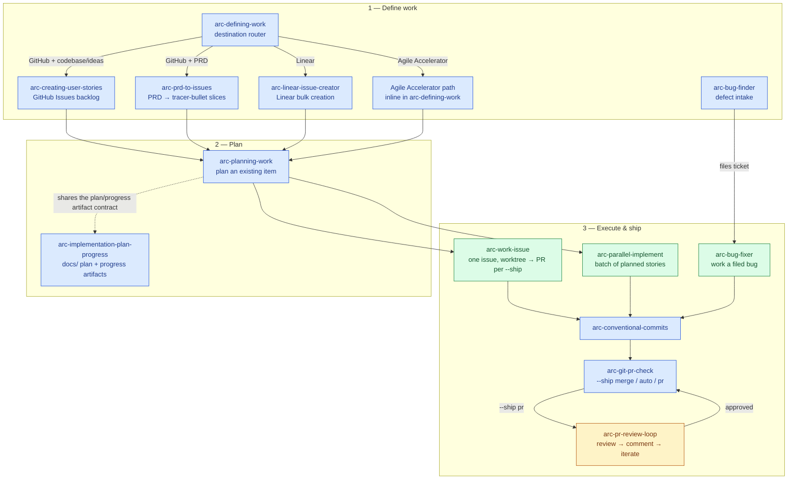

# arc-skills

Portable repository for ARC skills (`arc-*`) so they can be shared and installed on any machine.

## Contents

Each skill lives in its own directory and includes a `SKILL.md` entrypoint. Skills may also include an `evals/evals.json` suite consumable by [`arc-skill-eval`](https://github.com/andysolomon/arc-skill-eval).

## Skill pipeline

How the planning, creation, and execution skills fit together. `arc-defining-work` is the entry-point router when the destination tracker is open; go straight to a specialist when it is already fixed. The canonical story contract (job story + verifiable checklist acceptance criteria + `W-` numbering) lives in [`arc-creating-user-stories/STORY_FORMAT.md`](arc-creating-user-stories/STORY_FORMAT.md).



### Delegation strategy (non-Pi arc-orchestrator)

Colors mark who does the work when these skills run under the non-Pi external [arc-orchestrator](https://github.com/andysolomon/arc-orchestrator) path:

- **Blue — parent session (judgment & approval).** Defining, planning, routing, review judgment, acceptance, and approval stay in the premium parent session. Under orchestration, implementation and review workers never mutate git or GitHub.
- **Green — delegated implementation.** On the non-Pi external path, inside `arc-work-issue`, `arc-parallel-implement`, and `arc-bug-fixer`, route bounded coding through an implementation capability advertised by the installed `arc-orchestrator` surface. Do not assume a particular runner alias is installed or is the default. Orchestrated work is PR-first with `--ship pr` unless the caller explicitly authorizes `--ship auto` or `--ship merge`; standalone skill defaults and ship modes remain unchanged.
- **Amber — premium review.** `arc-pr-review-loop` routes review rounds through the review capability advertised by the installed external orchestrator. Review workers return findings to the parent; they do not post them. The parent judges the findings and delegates publication through `mechanical-post-comment`. The loop runs until approval (max 3 rounds), and merge happens only when authorized.

The non-Pi external route map is phase-specific: use the route IDs advertised by the installed `arc-orchestrator` capability surface for repository investigation, implementation, verification, and review. Every write-capable worker gets an isolated worktree; workers return evidence and never commit, push, comment, merge, deploy, edit secrets, or touch unrelated files. After accepting a diff, the parent delegates the conventional commit and push to `mechanical-commit-push`, directly opens the PR with `gh pr create`, delegates GitHub comments to `mechanical-post-comment`, and delegates an explicitly authorized merge or auto-merge to `mechanical-merge`. `arc-git-pr-check` and its full `--ship` behavior remain the standalone path outside orchestration. Any legacy external route alias is external-only and must not be presented as a native Arc Pi route.

### Arc Pi native parallel compatibility

`arc-parallel-implement` selects its runtime by capability: in Arc Pi, use the
native `subagent_spawn` plus `subagent_wait` surface only when both tools are
exposed; otherwise use the non-Pi external `arc-orchestrator` fallback only
when its advertised parallel capability surface is usable. If neither runtime
is usable, stop and report the blocker instead of simulating fan-out. The
native surface is nonblocking, session-scoped, and limited to four active
children. Batch larger sets, record each `arc-sub-...` ID, wait and inspect each
wave, and use `subagent_check`, `subagent_list`, `subagent_cancel`, or the
`/subagents`/`/sub` dashboard for lifecycle control. Native children use a
relative existing cwd inside the current project, so parallel worktrees belong
under `.arc/worktrees/` and that path belongs in clone-local `.git/info/exclude`.

Native children are isolated coding sessions without nested delegation,
extensions, or GitHub/shipping authority. The parent still owns planning,
acceptance, review, commit, PR, merge, and deploy decisions. External runner
aliases are not native Pi routes and must never be passed as a
`subagent_spawn` model value.

Model tiers are routing guidance, not runner route names. **Premier parent/planning:** Fable and Sol. **Smart reasoning/review:** GPT 5.5, Opus, Terra, Grok 4.5, GLM 5.2, and Luna. **Dumb/mechanical:** Composer 2.5, Sonnet 5, Haiku 4.5, Qwen 3 235B, MiniMax M3, Kimi 2.6, 5.4 nano/mini, and Deepseek variants. Prefer the cheapest tier that reliably fits the bounded phase while keeping planning, acceptance, review judgment, and approval with the parent and routing mutations through the required mechanical lanes.

Support skills: `arc-gitlab-glab` (GitLab delivery), `arc-creating-skill` + `arc-creating-evals` (author/maintain skills), `arc-system-design`, `arc-contract-review`, `arc-ideabrowser-openclaw-flow`, `arc-project-deploy-portfolio-sync`, `arc-sf-jwt-bearer`.

Design pyramid: an upside-down pyramid of five levels under `arc-design`, narrow at a static page and wider as each level adds something to run. Each level has a UI side and an architecture side. Level 1 is a page (`arc-html-response`), on one of two rungs: static, or scripted with one inline script for clicks CSS can't handle. Level 2 is an app (`arc-web-production`). The three levels above start from the app template and add an overlay to it, each with a test that proves the overlay on the current template in a real browser: `arc-interaction` (level 3) for a swipe that carries its velocity, rows that travel when a list changes and a spring the user can catch, through Motion's `animate()` in a Foldkit Mount; `arc-realtime` (level 4) for a room WebSocket on the app's Durable Object, presence, reconnect with catch-up and a WebRTC data channel; `arc-3d` (level 5) for a three.js scene coloured from the tokens, with `arc-webgl-performance` for frame rate. `arc-system-architecture` is the architecture side of every level. A tool that outputs a file is a maker, not a level: `arc-design/makers.md` lists them, `arc-design/film.md` holds the rules for a HyperFrames film, and `arc-design/reviews.md` lists the review skills that check finished work. `arc-web-production` builds web apps on the Effect stack: Foldkit (The Elm Architecture on Effect v4, no React), Vite, Story and Scene tests that run without a browser, and an Alchemy stack that deploys to Cloudflare. It starts from `template/`, a small working app with a mock API, a script-free static render and a Worker with a Durable Object; `tests/test-template.sh` proves a clean copy installs, typechecks, tests and builds. `arc-design` sits on top: it picks the level and the skill for a request and holds the one look every layer shares (`tokens.css`, checked against each copy by `scripts/check-tokens.mjs`), plus the taste and motion rules. Type is Geist first with system fonts behind it (the app template bundles the font files), and motion is CSS first, with Motion's `animate()` allowed from level 3 for three named cases. `arc-salesforce-engineering` builds screens and configuration inside a Salesforce org as a Salesforce DX project: Lightning Web Components with Jest tests, Apex that runs as the user, permission sets and Flows, deployed with the `sf` CLI (validate, then quick-deploy for production). It starts from `template/`, an account list with every state, its Apex and a permission set. `scripts/sync-tokens.mjs` generates the org's token module from `arc-design` (Salesforce blue, light values). `tests/test-template.sh` proves a clean copy passes without an org. `arc-system-architecture` decides where each part of a system runs, from a local process to Tailscale, Lakebed, Cloudflare, a container or Kubernetes, always the lowest rung that meets its needs. It reviews failure, state, secrets, reach, cost and undo, and draws the result as an architecture page. `scripts/inventory.sh` takes a read-only inventory of a repo and machine first; `tests/test-inventory.sh` checks it against a fixture.

Design skill: [`arc-article-to-images`](arc-article-to-images/SKILL.md) turns articles into source-grounded editorial images and educational carousels. Its default field-notes style uses warm paper, bold headlines, italic subtitles, cobalt accents, and explanatory diagrams. It delivers PNGs with source notes and alt text, using available image-generation or deterministic rendering tools. Example: `Use arc-article-to-images to turn <article URL> into a five-card field-notes carousel.`

For arc-reader, its cover mode follows the article structure: one article cover and one for every subsection, including nested subsections. Example: `Use arc-article-to-images to create article and subsection covers for <article URL>.` The number of covers follows the source; the app integration is described in the skill's [cover reference](arc-article-to-images/references/article-covers.md).

Response skill: `arc-html-response` answers structured replies (explanations, comparisons, plans, reviews, work reports) as a small HTML page instead of terminal prose. Every page follows the Postplan 0.0.4 contract (no JavaScript, inline CSS, no local paths), draws charts, diagrams and motion in SVG/CSS from `components.html`, and is checked by `scripts/lint.sh` (tests in `tests/test-lint.sh`). The scripted rung allows one inline script that keeps and sends nothing, for a step-through or a sortable table (`scripted.html`, checked by `lint.sh --scripted`); it reads in full on Postplan with the script off and links a claude.ai Artifact that runs it. Diagrams past a straight flow go through the optional [diagram-design](https://github.com/cathrynlavery/diagram-design) skill with the `arc-postplan` profile (`diagram-profile.md`, adapted from that project's MIT-licensed style guide; `scripts/install.sh` copies it to `~/.diagram-design/profiles/`). Charts come from `scripts/chart.mjs`. An illustration (opt-in) is a Hairline figure from [lucasmarkes/hairline](https://github.com/lucasmarkes/hairline), captured as a themed still by `scripts/hairline.mjs` with the live figure linked, or else a card from one of four MengTo/Skills styles (`illustration-isometric-mono`, `illustration-teal-spot`, `illustration-line-interior`, `illustration-halftone-line`). Requests that need state (a vote, a shared checklist, live numbers) route to a [Lakebed](https://lakebed.dev) app first, Cloudflare when they outgrow it; `lakebed.md` is the build, test and hand-over guide. Changes to the skill pass a release gate: three fresh-agent runs and a worst-case preview (`tests/fresh-agent.md`). It renders the page inline in T3 Code, publishes keepable write-ups to Postplan, and ends work reports with a review packet (revision, changes, evidence, PASS / FAIL / NOT_RUN checks, open items). It sits beside the pipeline rather than in it: any skill's final report can go through it.

### Mode skills

`andrew-mode` sets how work is done: reply shape, autonomy limits, what counts as verified, context hygiene, and prose discipline. It governs behavior only. Every workflow step defers to the arc skill that owns it, so the mode skill never routes work and never ships it.

It is user-invoked (`disable-model-invocation: true`), so it applies only when called by name. Invoke it alongside a pipeline skill rather than instead of one.

## Install (recommended: skills CLI)

These are open agent skills ([agentskills.io](https://agentskills.io) `SKILL.md` format), so any harness that reads skills can use them. The `vercel-labs/skills` CLI installs them into the universal folder `~/.agents/skills` (read by Codex, Pi, Cline, Warp, Zed and others) and links them into harnesses with their own folders (Claude Code, Cursor, OpenCode, Copilot and others).

### Install all ARC skills globally, for every harness you use

```bash
npx skills add andysolomon/arc-skills -g --skill '*'
npx skills update -g      # after new commits land on main
```

Without `-a`, the CLI asks which harnesses to link (and remembers the answer).

### List available skills in this repo

```bash
npx skills add andysolomon/arc-skills --list
```

### Install all ARC skills in the current project (cwd)

```bash
npx skills add andysolomon/arc-skills --skill '*'
```

### Install all ARC skills in cwd for Claude Code + Codex only

```bash
npx skills add andysolomon/arc-skills -a claude-code -a codex --skill '*'
```

### Install all ARC skills globally for Claude Code + Codex

```bash
npx skills add andysolomon/arc-skills -g -a claude-code -a codex --skill '*'
```

### Install only specific skills

```bash
npx skills add andysolomon/arc-skills -g -a claude-code -a codex --skill arc-implementation-plan-progress --skill arc-ideabrowser-openclaw-flow
```

### Copy mode (instead of symlinks)

```bash
npx skills add andysolomon/arc-skills -g -a claude-code -a codex --skill '*' --copy
```

## Local installer (for working on the skills)

```bash
./scripts/install.sh
```

This installs the same layout as the CLI, but links each skill to this checkout so edits are live:
- `~/.agents/skills/<name>` links to the checkout (the universal folder)
- `~/.claude/skills/<name>` links to `~/.agents/skills/<name>`

It also removes the `~/.codex/skills` links that older versions made, since Codex reads `~/.agents/skills`. Use the CLI or this script, not both: `npx skills update` replaces the links with copies.

Run `bash scripts/ci.sh` before a pull request: it runs what `.github/workflows/ci.yml` runs (`checks` for the fast part, `templates` for the template and overlay tests). Changing a `SKILL.md`? Run `bash scripts/check-skills.sh`: the CLI silently skips a skill whose frontmatter isn't valid YAML (an unquoted `: ` in the description is enough), and this check fails when that happens.

Use `--copy` to copy instead of symlink:

```bash
./scripts/install.sh --copy
```
